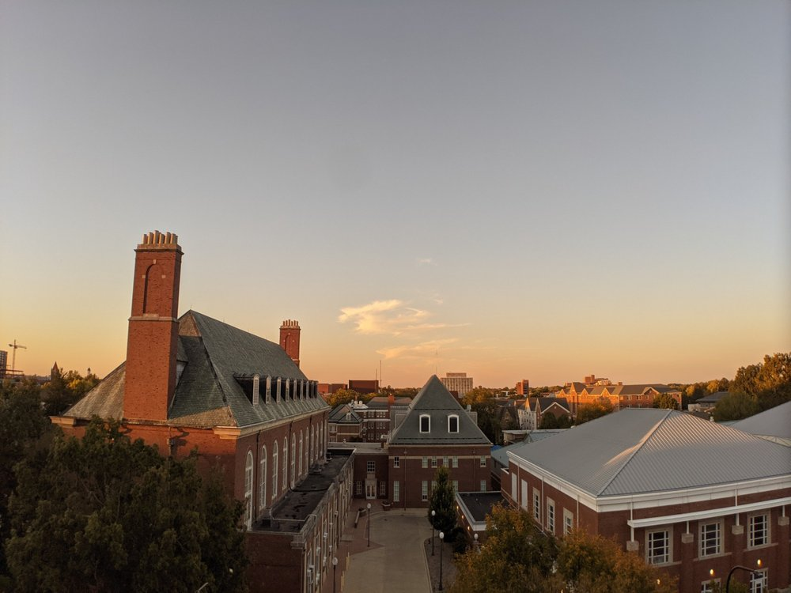
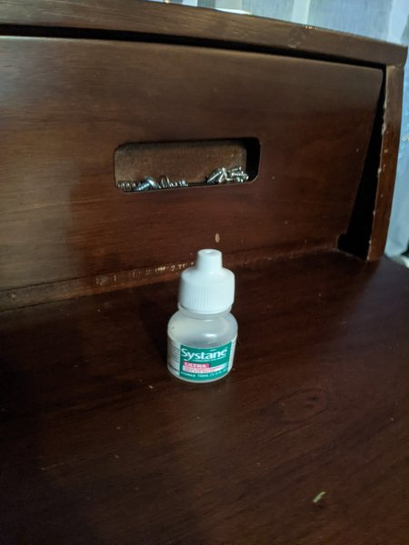
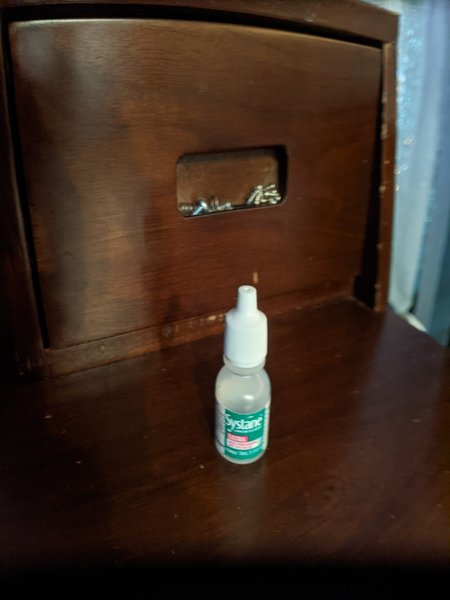

# Moment Anamorphic Lens Desqueeze for Android (1.33x & 1.55x)

[](https://github.com/VladislavEkimtcov/AndroidMomentAnamorphicLens/releases/latest)
[](https://github.com/VladislavEkimtcov/AndroidMomentAnamorphicLens/actions/workflows/ci.yml)
[](LICENSE)

**AndroidMomentAnamorphicLens** (app name: *Anamorphic Desqueeze*) is a free, open-source Android app
that **desqueezes photos taken with the Moment Anamorphic 1.33x mobile lens** (and the 1.55x lens).
It replaces the de-squeeze feature of the discontinued **Moment Pro Camera app for Android**.

Shoot with your phone's own camera app (for example Pixel Camera with HDR+ and Night Sight), open the
photo, tap **Share → Stretch**, and you get a correctly proportioned, desqueezed copy with all of
the original metadata. Google Photos picks it up and backs it up like any other photo.

<table>
  <tr>
    <th>Straight out of the camera (squeezed)</th>
    <th>After <em>Stretch</em> (desqueezed, 16:9)</th>
  </tr>
  <tr>
    <td></td>
    <td></td>
  </tr>
</table>

## Why this exists

An anamorphic lens squeezes a wider field of view horizontally onto the sensor. That gives the oval
bokeh and horizontal blue flares of widescreen cinema, but the photo has to be **desqueezed**
(stretched back) before it looks right. Moment's Pro Camera app did this on Android until Moment
[discontinued it in 2020](https://petapixel.com/2020/03/02/moment-discontinues-pro-camera-app-for-android-blames-phone-makers).
Third-party camera apps can desqueeze too, but they skip the phone's own computational photography
(HDR+, Night Sight, multi-frame noise reduction).

This app lets you keep the best camera pipeline on your phone and fixes the aspect ratio afterwards,
in two taps.

## Download

Get the latest APK from **[Releases](https://github.com/VladislavEkimtcov/AndroidMomentAnamorphicLens/releases/latest)**,
open it on your phone and allow the install when Android asks. Requires **Android 11 or newer**.

## How to use

1. Put the Moment anamorphic lens on your phone (with the Moment case or mount) and take photos with
   your regular camera app. They look squeezed: people look thin.
2. Open a photo in Google Photos, Files or any gallery and tap **Share**.
3. Pick **Stretch** to desqueeze it.
   Pick **Unstretch** to undo a stretch (or fix a photo you stretched by accident).

You can share several photos at once. The app opens once to set your preferences. After that it only
shows up in the share sheet.

## Settings

| Setting | What it does |
|---|---|
| **Squeeze factor**: 1.33x / 1.55x | 1.33x for the classic Moment Anamorphic lens (4:3 photos become 16:9, 1.78:1). 1.55x for Moment's 1.55x anamorphic lens. |
| **Rotate 90°** | Which way your lens squeezes. See below. |
| **Replace original** (on by default) | After saving the stretched copy, moves the squeezed original to the trash. Android asks you to confirm, and trashed photos can be restored for 30 days (for example from Google Photos → Library → Trash). |

### Rotate 90° and the hex tool

The anamorphic element can be turned inside its housing with Moment's
[hex tool](https://www.shopmoment.com/products/spare-anamorphic-hex-tool), so not every lens squeezes
the same way:

- **Off (default)**: the lens as Moment ships it, with flares horizontal when you shoot in landscape.
  Landscape photos come out too narrow and portrait photos come out too short.
- **On**: the lens was turned 90°. Portrait photos come out too narrow instead.

| | Squeezed | Stretched |
|---|---|---|
| Default orientation, phone held upright |  |  |
| Lens rotated 90°, phone held upright |  |  |

## How it works

- **Desqueeze math.** The squeezed side is stretched by the squeeze factor (exactly 4/3 for "1.33x",
  or 1.55). Pixels are added rather than removed, using high-quality Lanczos-3 resampling along that
  one axis only. A 4032×3024 Pixel photo becomes 5376×3024.
- **Orientation.** The squeeze follows the camera *sensor*, not how you held the phone. The app
  stretches the photo's long side by default and the short side with *Rotate 90°*. That works whether
  your camera rotates the pixels or only writes an EXIF orientation tag.
- **Metadata is preserved.** The original EXIF block is copied byte-for-byte: date and time, GPS
  location, camera model, exposure, lens data and the maker notes. Only the image size fields and
  the embedded thumbnail are updated. XMP, ICC color profiles (including Display P3) and comments are kept.
- **Exact undo.** *Stretch* records the original size in XMP, so *Unstretch* restores it
  exactly, even if your settings have changed since. *Stretch* also skips photos it already stretched.
- **Google Photos sync.** The stretched copy is saved through Android's MediaStore in the same
  folder as the original (usually `DCIM/Camera`), with the original "date taken". Google Photos backs
  it up automatically and shows it next to the original in your timeline.
- **File names.** `PXL_20201011_183000123.jpg` becomes `PXL_20201011_183000123_stretched.jpg`.
  Unstretch removes the suffix again.

### Good to know

- **Motion photos** (Top Shot / "Motion" on Pixel) become still photos, because the embedded video
  can't be stretched along with the picture. Portrait-mode depth data is dropped for the same reason.
- If Google Photos already **backed up** the squeezed original before you stretched it, delete it in
  Google Photos as well. The app can only remove the copy stored on the phone.
- **JPEG only.** Most phone cameras save JPEG by default. HEIC/HEIF and RAW/DNG aren't supported.
- **Photos only.** For video, use an editor that can set a 1.33x pixel aspect ratio (most desktop
  editors do), or record with the Blackmagic Camera app, which can desqueeze anamorphic video itself.

## Compatibility

- Android 11+ phones, developed on a **Google Pixel 3** with the Moment case and M-series mount.
- Works with any phone camera and any **1.33x or 1.55x anamorphic mobile lens**: Moment
  M-series and T-series (blue or gold flare), and other brands' 1.33x adapters such as
  Sandmarc, Ulanzi, Freewell or Apexel.

## Permissions and privacy

The app has **no internet permission**. Nothing leaves your phone.

| Permission | Why |
|---|---|
| Photos and videos (`READ_MEDIA_IMAGES` / `READ_EXTERNAL_STORAGE`) | Find the original photo in your library, to save the copy next to it and move the original to the trash. |
| Media location (`ACCESS_MEDIA_LOCATION`) | Android hides GPS coordinates from apps without it, and the copy would lose its location. |
| Media management (`MANAGE_MEDIA`, optional, Android 12+) | Move originals to the trash without a confirmation each time. |

The app can still stretch photos without these permissions. It just keeps the originals in that case.

## FAQ

**Is this the official Moment app?** No. It's an independent open-source project, not affiliated with
or endorsed by Moment. "Moment" is a trademark of its owner.

**Does stretching reduce quality?** Pixels are only added, never removed. The image is resampled
with Lanczos-3 and saved as JPEG at quality 95.

**Why not just crop the height instead?** That would throw away 25% of your pixels. Stretching keeps
everything the sensor captured, like Moment's app did.

**It stretched the wrong way!** Toggle **Rotate 90°**, share the stretched photo to **Unstretch**,
then **Stretch** it again.

## Building from source

Requires JDK 17 and the Android SDK (API 35).

```sh
./gradlew :core:test            # image-processing unit tests (plain JVM, no Android needed)
./gradlew :app:assembleDebug    # app/build/outputs/apk/debug/app-debug.apk
./gradlew :app:connectedDebugAndroidTest   # device/emulator tests
```

The project has two modules:

- `core/`: pure Kotlin. JPEG segment handling, in-place EXIF patching, XMP cleanup and Lanczos
  resampling, with unit tests.
- `app/`: the Android app. Share targets, MediaStore and settings.

## Releasing

Releases are built and signed by GitHub Actions ([`release.yml`](.github/workflows/release.yml)).
When CI passes on `main` and `versionName` in `app/build.gradle.kts` has no release yet, a signed APK
is published automatically. It needs these repository secrets:

| Secret | Value |
|---|---|
| `KEYSTORE_BASE64` | The release keystore, base64-encoded (`base64 -w0 release.jks`) |
| `KEYSTORE_PASSWORD` | Keystore password |
| `KEY_ALIAS` | Key alias |
| `KEY_PASSWORD` | Key password |

To ship an update, bump `versionCode` and `versionName` and add
`fastlane/metadata/android/en-US/changelogs/<versionCode>.txt`.

## Contributing

Issues and pull requests are welcome, especially reports from phones other than the Pixel 3. If a photo
comes out wrong, please open an issue with your phone model and camera app.

## License

[MIT](LICENSE) © Vladislav Ekimtcov
